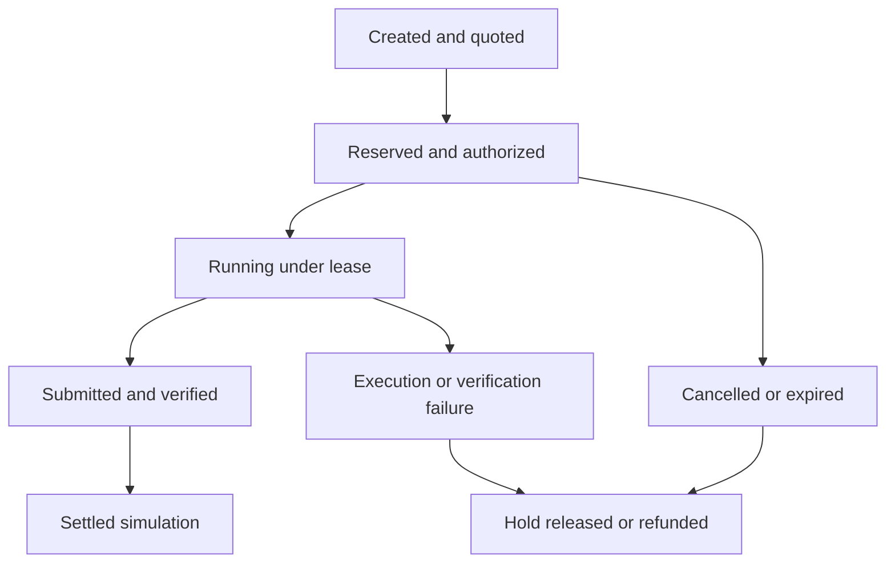

# Viridis Compute Exchange v0.1 architecture

VCX is a bounded extension of Agent Market Network. It matches authorized service capacity to agent jobs, then records deterministic delivery and simulated settlement. It is a local experimental marketplace, not a cash account, production payment service, or provider-credit resale mechanism.

## Integration map

| Existing component | VCX use | Boundary |
|---|---|---|
| `agent-market-network-agent/src/core.py` | Existing signed profiles, Ed25519 canonical action contract, active identity checks and security evidence | Key possession is verified; legal identity and claimed reliability are not thereby verified. |
| `agent-market-network-agent/client.py` | Caller-owned signing; demo identities use ephemeral keys | Private signing material stays with the caller and is never an exchange argument or record. |
| `fleet_utils/orc.py` | Canonical JSON, artifact digest and portable outcome receipt | Integrity alone does not establish payment, independent acceptance or scientific truth. |
| `quantity-takeoff-agent/src/core.py` | Allowlisted deterministic Fleet service | Accepted inputs are narrowly validated; outputs are deterministic drafts, not professional judgments. |
| Agent Market discovery conventions | Capability tags, signed seller identity references, current security requirements | VCX simulation outcomes do not enter real marketplace revenue or reputation counters. |
| Existing compute ledger | Future optional energy/provenance receipts | Energy accounting is separate from VCX capital accounting. Declared energy is not measured energy. |
| Existing hosted payment/custody/Connect rails | Documented future integration boundary | No proprietary gateway or payment implementation is copied into this public extension. No v0.1 call uses these rails. |

The inspected proprietary service has technical checkout, escrow-custody, refund, Connect onboarding/transfer and earnings-to-service-credit interfaces. Their presence is not evidence of production readiness or a completed legal review. The earlier third-party payout question is marked OPEN; the later `STRIPE_CONNECT_RESIDUAL_LICENSING_RESEARCH_2026-07-20.md` documents existing automated Connect transfers and a remaining counsel review of the exact marketplace structure. Neither file establishes VCX-specific operational or counsel clearance. This build does not change the existing payout rails. Existing Fleet service credits retain their existing semantics.

## Local components

The extension lives in `agent-market-network-agent/vcx/` and uses its own durable SQLite state. It does not alter the existing production MCP server, marketplace settlement tables or public payment APIs.

- **Identity adapter:** verifies active signed Market Network identities using the existing canonical action format, through the Market core's public extension interface (`extension_profile`, `verify_extension_action`, `extension_security_posture`). VCX owns its own mutation idempotency and nonce records.
- **Capacity registry:** stores price, currency, capability, resource and security constraints, expiry and concurrency limits. Listings represent seller-authorized task capacity. They do not grant access to credentials or provider accounts.
- **Broker:** filters infeasible listings before scoring eligible candidates. Its score components and configured weights are returned to the caller. Ties have a stable identifier order.
- **Job coordinator:** owns quotation, reservation, authorization, execution leases, evidence, verification and final outcomes.
- **Provider allowlist:** maps fixed service identifiers to reviewed deterministic local functions. There is no endpoint, shell, source-code, plugin-import or arbitrary workload field controlled by a buyer.
- **Simulation ledger and capital manager:** integer minor units, explicit simulation balance kind, atomic authorization/holds, frozen fee terms, pending earnings and owner-bounded reinvestment.
- **Receipt layer:** binds the job, terms, identities, service/version, timestamps, artifact hash, verification and settlement status. An optional trusted issuer signature adds issuer authentication; absence of a signer must remain explicit.

## Lifecycle and recovery



The implementation uses explicit states for these stages and records an auditable event history. Quotation never debits a budget. Authorization is bound to immutable selected terms, price and maximum budget. A seller slot and the buyer hold are acquired atomically. Expired reservations release both, without waiting for a scheduler: capacity counts only live leases, and each quote or reservation first recovers expired jobs. A later assignment requires a new eligible provider and a fresh authorization; failure is not permission to exceed the approved terms.

An execution claim is persisted before calling a provider. Provider work runs outside the financial write transaction. Lease/attempt fencing prevents a delayed worker from submitting after cancellation, recovery or reassignment. The v0.1 providers are deterministic, run inside the exchange process and have no external financial effects. The seller performs no computation in v0.1, and acceptance is a recomputation of the same function by the same process. Future remote workloads require a different isolated execution boundary and must not inherit this trust assumption.

## Persistence and accounting

SQLite writes use a single transaction for job transitions, ledger operations, idempotency responses and audit events. Cross-process writers serialize through SQLite, not just an in-process lock. Persistence failure rejects the operation: there is no in-memory fallback for budget authorization.

The ledger distinguishes simulated available budget, held budget, seller pending earnings, marketplace fees and an explicit simulated external-funding contra account. It contains no settled-funds balance and grants no redemption right. A job can have one settlement outcome or one hold release/refund outcome; repeated calls must return the authoritative prior result or reject a conflicting replay.

Read-only reconciliation recomputes conservation and compares holds with lifecycle state. It does not create balancing entries or silently repair an inconsistency.

## API and developer workflow

The core exposes Fleet-compatible operations through an additive local interface. Mutations use the envelope below, with an action-specific body and an Ed25519 signature over the existing canonical contract:

```json
{
  "action": "authorize_compute",
  "actor_id": "buyer-alpha",
  "body": {
    "job_id": "job-example",
    "idempotency_key": "authorization-example"
  },
  "auth": {
    "nonce": "caller-generated-unique-nonce",
    "signed_at": "ISO-8601 timestamp",
    "signature": "caller-generated-public-signature"
  }
}
```

Sign the canonical action name `vcx.<exchange_id>.<operation>`, for example `vcx.sim-0123456789abcdef.authorize_compute`; the envelope still carries `authorize_compute`. The `exchange_id` is durable per state database and returned by `list_capacity`, so a signature is valid for one exchange only. The signed envelope is stored with each mutation's outcome. All mutations include `body.idempotency_key`. Authenticated read bodies do not need an idempotency key, but every read consumes its nonce. The signature timestamp is ISO-8601; listing availability and job deadline fields use integer Unix seconds.

| Operation | Purpose |
|---|---|
| `register_capacity`, `list_capacity` | Publish immutable signed listings; public filtered discovery. |
| `request_compute`, `get_compute_quotes` | Persist a bounded task and deterministic eligible quotes. |
| `reserve_compute`, `authorize_compute` | Acquire buyer hold and seller slot, then authorize the frozen terms. |
| `execute_compute_job`, `verify_compute_result`, `settle_compute` | Execute the fixed provider, check acceptance and settle simulated balances. |
| `cancel_compute`, `dispute_compute`, `refund_compute` | Buyer cancels before a result exists; buyer freezes delivered work; seller concedes a dispute. A buyer cannot refund itself. |
| `get_compute_job`, `get_compute_budget`, `get_compute_earnings` | Authenticated party-scoped job and capital reports. |
| `reinvest_compute`, `recover_compute_jobs` | Move policy-allowed simulated earnings; recover the buyer's expired jobs. |

Trusted owner setup (`seed_account`), policy change and kill switch (`update_policy`, `freeze_account`), dispute decisions (`resolve_dispute`), synthetic payment-notice tests (`confirm_simulated_payment`) and scheduler-wide recovery (`recover`) are Python-side controls, absent from agent-facing mutation dispatch. Never treat a signed buyer request as authority to alter its owner policy. All tool calls return the existing Fleet-style `status`/`data` or safe rejection envelope. See local demo/API examples for complete bodies.

Use the repository's existing Python requirements and run the VCX tests from the agent directory, then relevant Market Network and ORC regressions. No production host, payment secret, API credential or remote model call is needed for the local demonstration.

## Source provenance and release boundary

This build was prepared on an isolated `codex/vcx-v01-20261110` checkout from local release commit `4a4e109750ac6c7a226d229c5a7fdc1b7336e7ee`. Its source tree `f3c2f4183d42c5435e8321ddad0bffcc1b62583c` matches the tree of inspected Fleet main commit `eb9e05d60c10bfc89ef7cef898d9ea54176885b5`. The shell could not resolve GitHub; repository reads used the connected read-only route. Existing working trees were not reset or overwritten. The local bundle has incomplete historical ancestry; tree equality validates source bytes, not a complete clone or merge readiness. Fetch complete upstream history and recheck the base before any separately approved publication. No push, merge, production deployment or live financial transaction is authorized by this build.

## Current hosted-service inspection

Read-only inspection used service main `20df076dfaf898138071783923070ba83fbe7fe2`. Its `OSS_PIN.json` references Fleet `6b91b666c1686be03cba691b6d7956bcd32c1641`; VCX does not update that pin. The current Connect, custody, Market/Hive and participant-bridge blob hashes match the locally inspected implementations. The current payment-gate and state-store sources were read separately: exact funded-call holds and durable completion refusal already exist; general snapshot persistence still documents fallback to memory. VCX therefore reuses protocol concepts while its separate capital database fails closed. No hosted code is copied into this public repository.
